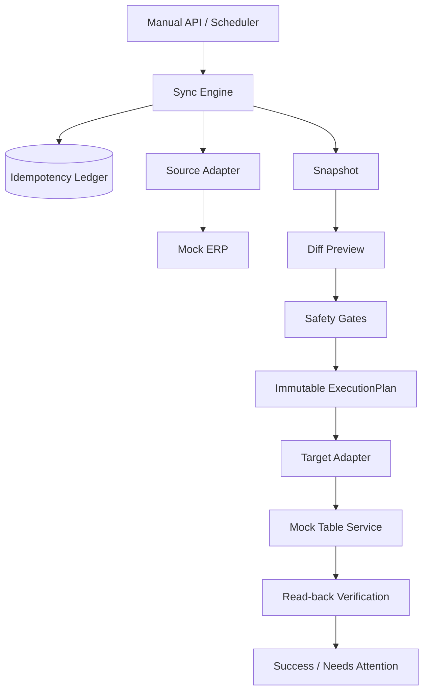
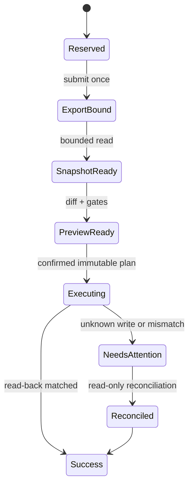

# Reliable RPA Sync Engine

一个面向生产自动化场景的 Python 参考实现，重点解决 **外部操作不可安全重试、任务崩溃、目标漂移和同步成功假阳性** 等问题。

本项目基于真实企业自动化项目中积累的工程经验独立编写。公开代码不是原生产仓库的镜像；ERP、飞书及业务数据均由 Mock Adapter（模拟适配器）和虚拟数据替代。幂等账本、安全门、不可变执行计划、故障恢复和写后核验是完整实现，不是接口占位符。

## 项目价值

传统 RPA 脚本通常假设“点击成功就等于业务成功”。真实系统会遇到响应超时、浏览器崩溃、页面瞬态加载失败、重复调度和远端写入结果未知。本项目把这些不确定性建模为可持久化状态，并明确区分：

- 可以有限重试的无副作用读取；
- 绝不能自动重试的未知写入；
- 可以只读对账恢复的已绑定外部任务；
- 必须重新生成 Preview（预览）的输入或目标变化。

## 核心能力

- SQLite operation ledger（操作账本）保证同一外部提交最多尝试一次
- Snapshot（快照）和 ExecutionPlan（执行计划）使用稳定指纹冻结
- Target、Schema、主键、Conflict、环境和 Blast Radius 安全门
- 无副作用读取的有限重试与退避
- 写入结果 UNKNOWN 时停止自动重放
- 主键级 Read-back（写后核验）
- NOOP（无需修改）任务的正确成功终态
- Scheduler/Worker lease 防止并发重复领取
- 可替换的 Source/Target Adapter
- 面向失败路径的自动化测试

## 系统架构



## 核心流程



1. 在本地账本中预留操作身份。
2. 调用一次外部 Export，并绑定返回的外部任务编号。
3. 使用同一外部任务编号有限轮询，构建带指纹的 Snapshot。
4. 读取目标并生成 CREATE、UPDATE、NOOP 差异。
5. 冻结目标身份和变更内容，形成不可变 ExecutionPlan。
6. 执行前重新校验 Snapshot、Target 和所有安全门。
7. 写入后按主键回读；全部匹配才返回 SUCCESS。
8. 写入响应未知时记录 UNKNOWN，不自动执行第二次写入。

## 技术难点与解决方案

### 外部写入超时不能直接重试

远端可能已经提交成功，只是响应丢失。引擎在调用前持久化 submit intent（提交意图），出现未知结果后锁定该操作，要求只读对账。

### Preview 和实际写入目标可能漂移

ExecutionPlan 保存 Snapshot 指纹、目标身份和 Schema 指纹。执行前再次检查，任何变化都会以 `SNAPSHOT_STALE` 或 `TARGET_MISMATCH` 停止。

### 自动任务可能被多个 Worker 同时领取

`LeaseStore` 使用带过期时间和所有者 Token 的 lease。同一计划只有一个 Worker 能获得有效租约，释放时也必须匹配原 Token。

### 零变更任务不应产生假写入

纯 NOOP 计划不调用写接口，也不伪造写后核验；任务以真实 NOOP 计数成功结束。

## 项目结构

```text
reliable-rpa-sync-engine/
├── src/reliable_sync/
│   ├── adapters.py       # 外部系统协议与 Mock 实现
│   ├── api.py            # FastAPI 健康接口
│   ├── domain.py         # 状态、快照、差异和执行计划
│   ├── engine.py         # 同步编排与写后核验
│   ├── gates.py          # 可组合安全门
│   ├── ledger.py         # SQLite 幂等账本
│   ├── planning.py       # Preview 与计划冻结
│   ├── retry.py          # 只读有限重试
│   └── scheduler.py      # Worker lease
├── tests/                # 正常链与故障注入测试
├── examples/run_demo.py
└── docs/
```

## 安装

```powershell
python -m venv .venv
.\.venv\Scripts\python.exe -m pip install -e ".[dev]"
```

## 运行演示

```powershell
.\.venv\Scripts\python.exe examples\run_demo.py
```

启动健康接口：

```powershell
.\.venv\Scripts\python.exe -m uvicorn reliable_sync.api:app --host 127.0.0.1 --port 8080
```

访问 `http://127.0.0.1:8080/health`。

## 测试

```powershell
.\.venv\Scripts\python.exe -m pytest
```

测试覆盖重复提交、未知写入、读取瞬态失败、Snapshot 过期、目标漂移、主键异常、写入范围超限、NOOP、Read-back 和 Worker lease。

## 真实经验与公开实现边界

### 真实生产经验

该设计来自真实企业 RPA 数据同步项目：系统包含定时任务、无界面浏览器、数据导出、文件校验、差异预览、正式写入、写后核验和故障恢复。原生产项目已有大规模自动化测试与真实闭环验证。

### 本仓库的公开实现

本仓库代码为独立编写的参考实现，用于展示上述通用工程方法。仓库自己的测试结果必须通过本仓库测试命令重新产生。

### 模拟部分

- ERP 导出与下载
- 表格服务 API
- 订单字段和业务数据
- 故障响应

本仓库不包含真实公司源码、凭证、客户数据、平台选择器、内部接口、生产部署配置或原始 Git 历史。

## 已知限制

- Mock Adapter 不用于连接真实 ERP 或飞书。
- 当前参考实现使用同步接口，未演示跨进程消息队列。
- SQLite 适合本地演示；多实例生产部署需要具备事务锁语义的共享数据库。
- 示例只展示单数据集，真实系统中的多目标编排可在同一安全内核上扩展。

## 个人贡献说明

公开项目的架构选择、状态模型、安全机制、测试策略和代码整理基于本人参与真实自动化系统开发与故障处理的经验。实现过程中使用 AI 辅助代码生成、检查和文档整理；业务规则判断、安全边界和最终验收由本人负责。仓库不声称公开了原公司生产源码。

## 进一步阅读

- [Architecture](docs/architecture.md)
- [Design decisions](docs/design-decisions.md)
- [Testing strategy](docs/testing.md)
- [Troubleshooting](docs/troubleshooting.md)
