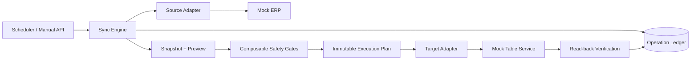

# Architecture

## Boundaries

- `SourceAdapter` owns external export submission and read-only result retrieval.
- `OperationLedger` prevents a second submit after an external operation is attempted.
- `Snapshot` freezes input data with a deterministic fingerprint.
- `ExecutionPlan` freezes changes and target identity before a write.
- `GatePolicy` rejects stale snapshots, target drift, conflicts, wrong environments and excessive write scope.
- `TargetAdapter` performs writes; an unknown result is never retried automatically.
- Read-back compares every planned row with the current target state before returning success.

The public adapters are simulations. The safety semantics are complete implementations.
